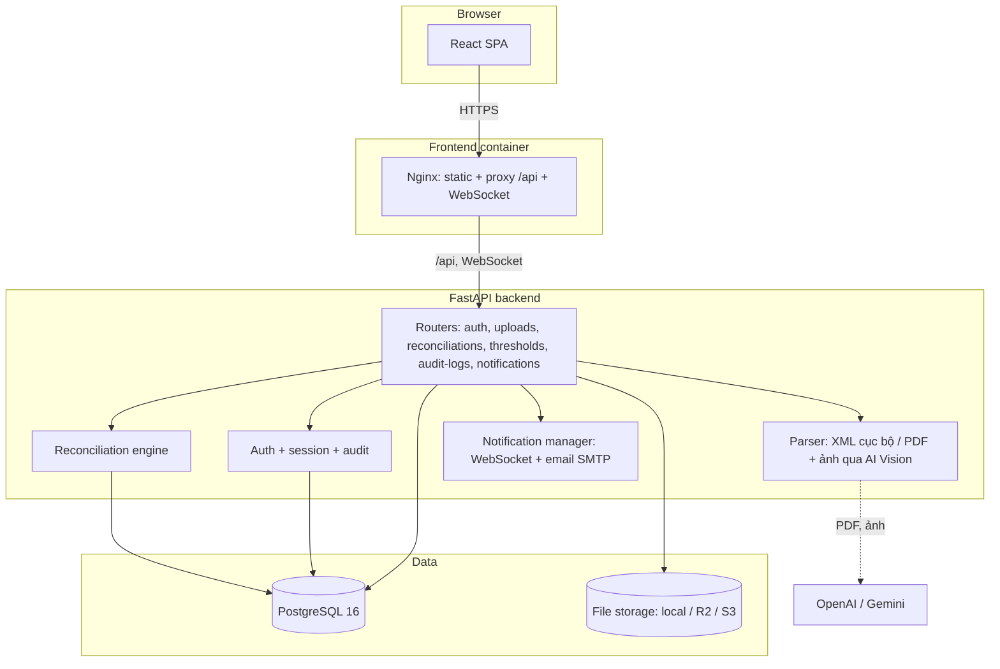
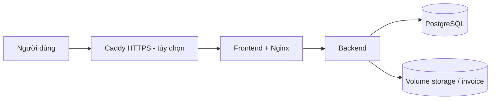

# Kiến trúc DocuSyncAI

## Tổng quan

DocuSyncAI đối soát ba bên giữa đơn đặt hàng (PO), phiếu nhập kho (GRN) và hóa đơn (Invoice). Ứng dụng web React gọi API FastAPI; backend bóc tách dữ liệu từ chứng từ (XML bằng parser cục bộ, PDF và ảnh bằng AI Vision), chạy engine đối soát theo ngưỡng sai số cấu hình được, rồi đưa hồ sơ qua quy trình phê duyệt hai cấp giữa kế toán viên và kế toán trưởng. Mọi thao tác quan trọng đều được ghi audit log.

## Sơ đồ

## Thành phần

### Frontend (`frontend/`)
React 18 + Vite + Tailwind. Trang chính: tải chứng từ (`UploadQueue`), tổng quan kế toán viên, duyệt batch của kế toán trưởng, chi tiết hồ sơ đối soát, nhật ký thao tác, cấu hình ngưỡng, quản lý người dùng. So sánh ba chứng từ phía giao diện nằm ở `reconciliationCompare.js` (có unit test). Nhận thông báo realtime qua WebSocket `/api/v1/notifications/ws`.

### Nginx (`frontend/nginx.conf`)
Phục vụ file tĩnh, proxy `/api/` tới backend (kèm header `Upgrade` cho WebSocket), giới hạn body 25 MB, gắn các header bảo mật (CSP, `X-Frame-Options`, `nosniff`, `Referrer-Policy`). HTTPS do Caddy (profile `https`) hoặc lớp proxy của hạ tầng đảm nhiệm.

### Backend (`src/`)
- `api/`: các router theo nghiệp vụ. Xác thực bằng bearer token; phân quyền theo vai trò `accountant` và `chief_accountant`.
- `services/document_parser.py`: đọc XML hóa đơn GDT, UBL và lược đồ tiếng Việt (`DonDatHang`, `PhieuNhapKho`).
- `services/document_ai_extractor.py`, `vision_parser.py`, `parser_strategies.py`: bóc tách PDF và ảnh bằng OpenAI hoặc Gemini, có chế độ dự phòng ngoại tuyến khi không có API key.
- `services/reconciliation_engine.py`: so khớp theo dòng hàng (SKU hoặc tên), đơn giá, số lượng, VAT, mã số thuế và tổng tiền; phân loại `matched`, `minor_diff`, `major_diff` theo ngưỡng trong bảng `thresholds`.
- `services/auth.py`: băm mật khẩu bcrypt, phiên đăng nhập, OTP đổi mật khẩu, giới hạn đăng nhập sai, audit log.
- `services/s3_service.py`, `email.py`, `notifications.py`: lưu file, gửi mail, đẩy thông báo.
- `logging_config.py`: log dạng text hoặc JSON, kèm `X-Request-ID`.
- `agents/`: agent LangGraph mẫu cho `/api/v1/chat`. Frontend không dùng và endpoint tắt mặc định (`ENABLE_AGENT_CHAT_API`).

### Cơ sở dữ liệu
PostgreSQL 16 qua SQLAlchemy. Schema do **Alembic** quản lý (`migrations/`). Revision `0001` là baseline idempotent cho cả DB mới lẫn DB đã có; mọi thay đổi schema sau đó phải là một revision riêng (`alembic revision -m "..."`). Backend chạy `alembic upgrade head` khi khởi động (tắt bằng `RUN_MIGRATIONS_ON_STARTUP=false` nếu muốn tách thành bước deploy).

Bảng chính: `users`, `roles`, `user_sessions`, `password_reset_otps`, `document_batches`, `uploaded_files`, `uploaded_document_extractions`, `reconciliation_cases` cùng các dòng hàng, `thresholds`, `notifications`, `audit_logs`.

## Luồng nghiệp vụ

1. Kế toán viên tải PO, GRN, Invoice vào một batch (giới hạn `MAX_UPLOAD_BYTES`, mặc định 20 MB mỗi file).
2. Backend bóc tách dữ liệu và kiểm tra loại chứng từ; batch chuyển `incomplete` thành `ready` khi đủ ba loại.
3. Engine đối soát tạo hồ sơ với trạng thái và các dòng bị lệch.
4. Kế toán viên duyệt (`approved`), kế toán trưởng duyệt cuối (`final_approved`) hoặc từ chối (`rejected`, kèm thông báo realtime và email).
5. Mỗi bước ghi audit log; kế toán viên chỉ xem log của chính mình, kế toán trưởng xem tất cả.

### Lưu trữ bộ chứng từ đã duyệt

Bộ PO + GRN + Invoice đã qua hai lần duyệt (`final_approved`) là hồ sơ lưu trữ và **không bao giờ bị xóa hay sửa**:

- Bản ghi batch, các file gốc (xem lại được qua `GET /api/v1/uploads/{id}/file`), dữ liệu bóc tách, kết quả đối soát, người duyệt ở cả hai cấp và audit log đều được giữ lại và hiển thị trong danh sách batch (bộ lọc "Đã duyệt") của cả kế toán viên lẫn kế toán trưởng. Danh sách không giới hạn theo thời gian hay số lượng.
- Từ trạng thái `approved` trở đi API từ chối thêm, xóa chứng từ (HTTP 409). Từ `final_approved`, API còn từ chối xóa batch, sửa ghi chú, và không thể từ chối lại.
- Lớp bảo vệ thứ hai ở database (migration `0002`): trigger chặn `DELETE` trên `document_batches`, `uploaded_files` và `uploaded_document_extractions` của batch `final_approved`, kể cả khi có lỗi mã hay chạy SQL thủ công.
- Để xóa hợp lệ theo chính sách lưu trữ, cần một thao tác có chủ đích hạ trạng thái batch, không xảy ra trong luồng nghiệp vụ thường.

## Bảo mật

| Hạng mục | Cách làm |
|---|---|
| Mật khẩu | bcrypt; chính sách tối thiểu 8 ký tự, có chữ và số, loại bỏ mật khẩu phổ biến |
| Phiên | Token ngẫu nhiên 32 byte, lưu băm SHA-256, hết hạn sau 12 giờ, thu hồi được |
| Brute force | Chặn theo cặp email và IP, theo IP, theo email trong cửa sổ cấu hình; trả 429 |
| Phân quyền | Kiểm tra vai trò ở từng endpoint; mọi endpoint nghiệp vụ yêu cầu đăng nhập (ngoại lệ: đăng nhập, health check, ảnh đại diện) |
| Cấu hình production | Từ chối khởi động nếu còn mật khẩu DB mặc định hoặc mật khẩu seed yếu; tắt Swagger |
| Tài khoản mặc định | Seed dùng mật khẩu ngẫu nhiên hoặc `SEED_DEFAULT_PASSWORD`; tài khoản còn mật khẩu cũ `123456` bị đặt lại ở production |
| Upload | Giới hạn dung lượng ở backend và Nginx; XML đọc bằng parser cục bộ, chỉ PDF và ảnh mới gửi sang AI |
| Hồ sơ đã duyệt | Khóa ở API và trigger database, xem mục "Lưu trữ bộ chứng từ đã duyệt" |
| Mạng | Compose production không mở cổng backend và DB; DB dev chỉ bind `127.0.0.1` |
| Truy vết | Audit log và `X-Request-ID` trên mọi phản hồi |

## Triển khai

- `docker-compose.yml`: cấu hình production-safe (không mount mã nguồn, không dữ liệu demo, healthcheck đầy đủ).
- `docker-compose.override.yml`: tiện ích dev, tự nạp khi chạy `docker compose up`.
- Hướng dẫn chi tiết, sao lưu và khôi phục: xem [DEPLOYMENT.md](DEPLOYMENT.md).

## Quyết định thiết kế

| Quyết định | Lựa chọn | Lý do |
|---|---|---|
| Backend | FastAPI | Async, kiểm tra kiểu bằng Pydantic, tài liệu API tự sinh |
| Cơ sở dữ liệu | PostgreSQL | Giao dịch, JSONB cho audit log, ràng buộc toàn vẹn |
| Migration | Alembic, baseline idempotent | Tương thích DB đã có dữ liệu, thay đổi sau này có phiên bản rõ ràng |
| Rate limit đăng nhập | Đếm từ `audit_logs` | Không thêm hạ tầng (Redis); hoạt động đúng với nhiều tiến trình |
| Bóc tách XML | Parser cục bộ | Chính xác, nhanh, không tốn phí AI; AI chỉ dùng cho PDF và ảnh |
| Frontend | React + Vite, serve bằng Nginx | Build tĩnh, dễ cache, cùng origin với API nên không cần CORS rộng |
